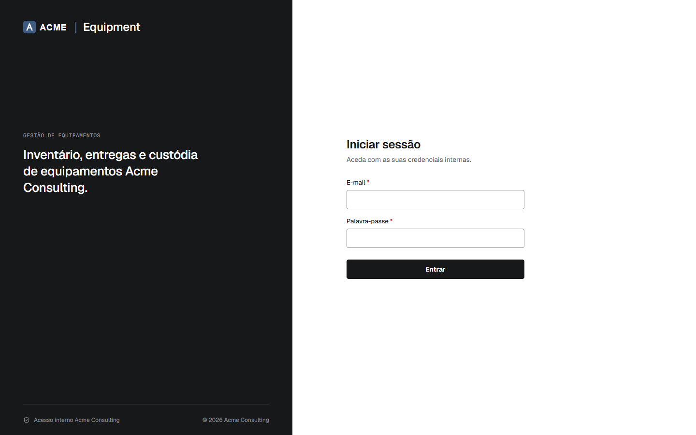
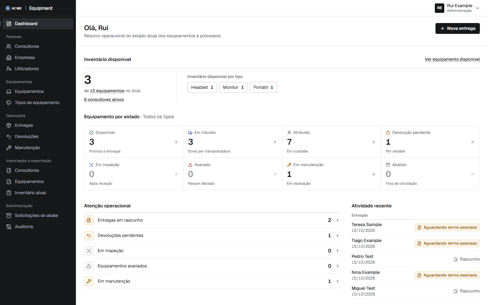
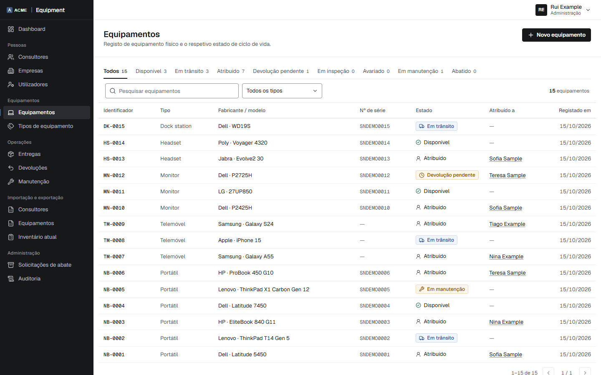
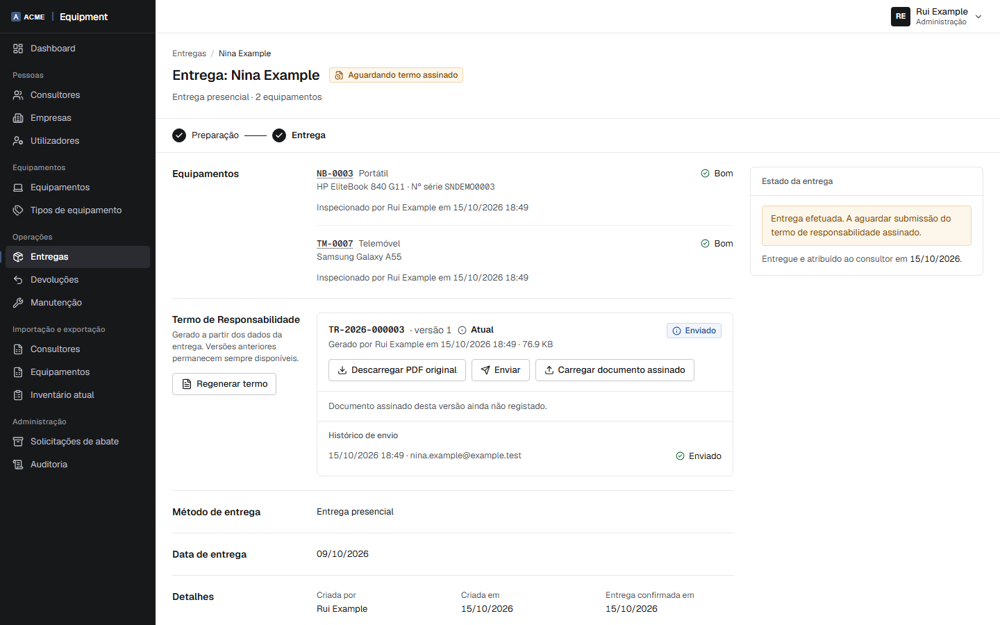
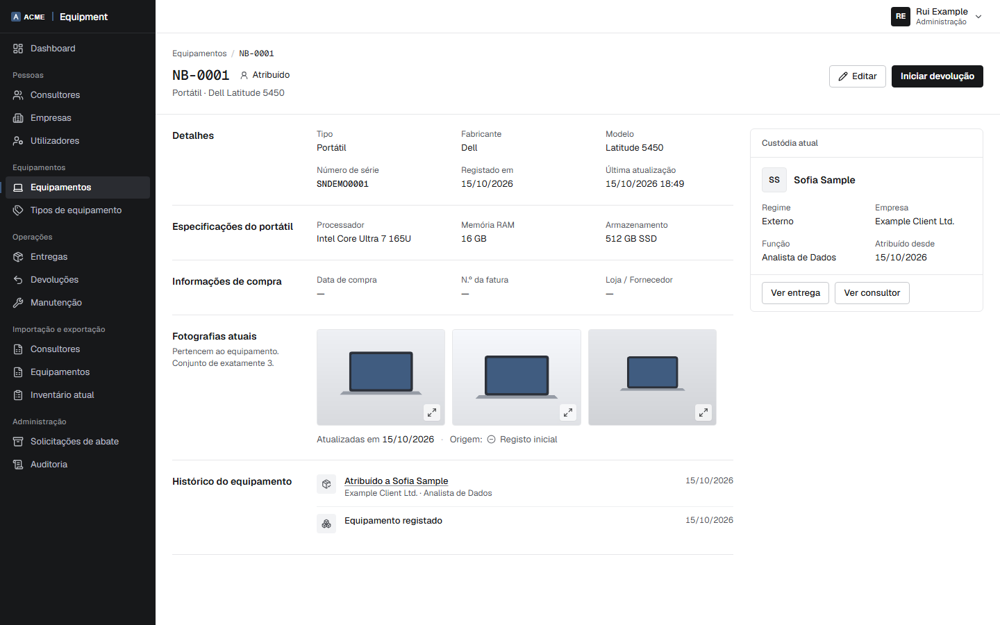

# Equipment Management

> **Publicly viewable source for portfolio, technical evaluation and
> demonstration. Proprietary — not open-source software.**
> No permission is granted to use, deploy, modify or redistribute it.
> See [License / Usage](#license--usage).

## About the project

Equipment Management is a full-stack web application I developed to help companies keep track of their equipment.
The idea came from the need to organise processes such as assigning laptops and phones to employees, managing returns and keeping track of who is responsible for each device.
The application brings these processes together in one place, making it easier for HR and Administration teams to manage equipment without relying on spreadsheets or manual records.
I worked on both the backend and frontend, using C#, ASP.NET Core, React, TypeScript and PostgreSQL.

### Why the domain is non-trivial

- **Custody must never be ambiguous.** An item can be with one person at most,
  even under concurrent requests. Lifecycle changes run in Serializable
  transactions backed by partial unique indexes.
- **Evidence must not change after the fact.** Each Responsibility Term
  version keeps an immutable snapshot of the people, equipment and condition
  photos it was generated from, and its SHA-256.
- **Side effects live outside the database.** PDFs, private files and emails
  cannot share a transaction with PostgreSQL, so each operation is ordered so
  that a failure leaves a truthful record rather than a silent gap.
- **Personal data is handled deliberately.** The audit log records which
  sensitive fields changed, not their values; logs avoid personal data;
  import previews are purged when they expire.
- **One codebase, several organisations.** Branding and legal wording are
  compiled in from a client profile, without client conditions in the code.

## Key Features

- **Equipment inventory.**
  - Equipment types with an asset-tag prefix: generic items, laptops
    (processor, memory, storage) and mobile phones (IMEI, number, SIM).
  - Unique normalised serial numbers and IMEIs.
- **Consultants, companies and allocations.**
  - An allocation is an engagement period: internal or external workforce,
    engagement type, role, and the client company for external work.
  - Ending an engagement creates the returns for everything the person
    holds, in one transaction, and sends one collection email.
- **Handovers.**
  - **In-person delivery:** inspect each item, then confirm delivery.
  - **Carrier delivery:** dispatching moves equipment to *In transit*;
    custody starts only when delivery is confirmed.
  - **Cancel dispatch:** before delivery is confirmed, with a mandatory
    reason that is kept as history.
- **Responsibility Terms.**
  - Versioned PDF documents with one signature block and a blank
    reception-date field for the recipient.
  - Each version keeps an immutable snapshot of the data it was rendered
    from.
  - Signed copies are uploaded and kept as evidence.
- **Condition-photo sets.**
  - Laptops and phones always have exactly three current photos.
  - Every change creates a new immutable set; earlier sets become history.
- **Returns and inspections.**
  - Custody ends at physical receipt.
  - The inspection decides between *Available* and *Damaged*, with damage
    evidence when needed.
- **Damage and maintenance:** a repair ends as repaired or not repairable.
- **Retirement:** HR may request it; only Administration approves or
  executes it.
- **Excel import and export.**
  - Templates with in-cell dropdowns.
  - Formulas and macro-enabled files are rejected.
  - Exports are protected against formula injection.
- **Audit:** an append-only audit log, written in the same transaction as
  the change it records, without personal data or secrets.
- **Role- and permission-based access.**
  - Two roles: Administration and HR.
  - Explicit permission policies on every endpoint.

## Screenshots

Captured from the neutral `default` profile with synthetic data. The UI is in
Portuguese (pt-PT).

| | |
|---|---|
|  |  |
| **Sign-in.** Internal staff only; consultants never sign in. | **Dashboard.** Equipment by state and items needing attention. |
|  |  |
| **Equipment.** Every asset with its state and current holder. | **Delivery.** Items, inspection, the term version and its send history, awaiting the signed copy. |



**Equipment detail.** Specifications, the current condition-photo set, the
current holder and the item's history.

## Domain Lifecycle

```
              Registar envio            Confirmar entrega
 Available ─────────────────▶ InTransit ─────────────────▶ Assigned
     ▲   ▲                       │                            │
     │   └──── Anular envio ─────┘                            │ return initiated
     │                                                        ▼
     │                                                  ReturnPending
     │                                                        │ physical receipt
     │      inspection without damage                         ▼
     ├──────────────────────────────────────────────── UnderInspection
     │                                                        │ damage found
     │      repaired                                          ▼
     ├────────────────────── UnderMaintenance ◀───────── Damaged
     │                              │ not repairable          ▲
     │                              └─────────────────────────┘
     ▼
  Retired  (from Available or Damaged, Administration only)
```

- In-person delivery goes from *Available* straight to *Assigned*.
- **Custody derives only from an active `EquipmentAssignment`.** It is
  created when delivery is confirmed and ended at the physical receipt of a
  return.
- *In transit* is a logistics state, not custody.

The full model is in [docs/DOMAIN_MODEL.md](docs/DOMAIN_MODEL.md).

## Architecture

A modular monolith with a layered backend, a single-page frontend and one
PostgreSQL database.

```
React SPA ──HTTPS (same origin)──▶ Caddy ──▶ ASP.NET Core API ──▶ PostgreSQL
                                                   │
                                                   ├──▶ private file storage (volume)
                                                   └──▶ SMTP
```

- `Domain`: framework-free entities and rule classes.
- `Application`: application wiring.
- `Infrastructure`: EF Core, services, files, email, PDF and Excel.
- `Api`: controllers, filters, middleware.

**One deployment serves exactly one organisation.** This is not database
multi-tenancy. See [docs/ARCHITECTURE.md](docs/ARCHITECTURE.md).

## Technology Stack

| Area | Technology |
|---|---|
| Backend | ASP.NET Core (.NET 10), API-only controllers |
| Persistence | PostgreSQL 18, EF Core 10 / Npgsql, code-first migrations |
| Authentication | ASP.NET Core Identity, cookie authentication (no JWT) |
| Documents | PDFsharp-MigraDoc with embedded open-licensed fonts |
| Spreadsheets | ClosedXML |
| Email | MailKit / MimeKit over SMTP |
| Frontend | React 19, TypeScript, Vite, Tailwind CSS 4, TanStack Query, React Router, react-hook-form + zod |
| Tests | xUnit (unit, and integration tests against real PostgreSQL), Vitest + Testing Library |
| Deployment | Docker Compose, Caddy (automatic HTTPS), one API instance |
| CI | GitHub Actions workflow: build, tests, EF model drift check, dependency audit |

## Some challenges during development
One of the main challenges was handling equipment assignments correctly, especially when multiple users try to assign the same device.
I also worked on generating PDF responsibility documents, managing their versions and making sure previous records remain unchanged.
Another important part was implementing authentication, user permissions and protecting sensitive files.
These challenges helped me improve my understanding of backend development, database relationships, application security and how different parts of a full-stack application work together.

## Security Model

Main controls:

- Cookie authentication (HttpOnly, Secure, `SameSite=Strict`). Every request
  re-validates the user, the security stamp and the permission set.
- Logout revokes all of the user's sessions.
- A CSRF token is required on every mutating request, login included.
- Every endpoint has an explicit permission policy, with a fail-closed
  default.
- Nested resources verify their full ownership chain.
- Private files are validated by content, never served statically, and
  streamed only to authorised users.
- Serializable transactions and partial unique indexes protect the
  lifecycle against races.
- In Production, the API refuses to start with missing or placeholder
  configuration.

Implemented controls and known limitations:
[docs/SECURITY.md](docs/SECURITY.md).

## Responsibility Terms

A Responsibility Term is the PDF a Consultant signs when receiving equipment.

- It lists every item, the current condition photos of laptops and phones,
  and the device-specific clauses of the deploying organisation.
- Regenerating a term creates a new version and supersedes the previous one.
- PDFs, their SHA-256 and their snapshots never change.
- The signed copy is uploaded as a PDF.

> **Demo Responsibility Term wording is provided only to demonstrate the
> document-generation feature.** Organisations must obtain their own legal
> review and provide their own legally appropriate wording before production
> use. The demonstration term prints a notice saying so.

## Local Development

Prerequisites: .NET SDK 10, Node.js 24 and Docker with Compose.

```bash
cp .env.example .env                 # throwaway local database credentials
docker compose up -d                 # PostgreSQL 18 on 127.0.0.1:5432
dotnet dev-certs https --trust       # once per machine
```

Start the API once with a bootstrap administrator and a fictional document
issuer. In Development the database is migrated automatically.

```bash
BootstrapAdmin__Enabled=true \
BootstrapAdmin__Email="admin@example.invalid" \
BootstrapAdmin__FirstName="Ana" BootstrapAdmin__LastName="Demo" \
BootstrapAdmin__Phone="+351900000000" \
BootstrapAdmin__Password="Local-Dev-Only-changeme-1" \
Documents__Issuer__LegalName="Acme Consulting, Lda. (demonstração)" \
Documents__Issuer__Address="Rua Exemplo 1, 1000-001 Lisboa" \
Documents__Issuer__TaxId="999999990" \
dotnet run --project src/backend/EquipmentManagement.Api --launch-profile https
```

These credentials are synthetic and for local development only. The
Production startup validation rejects them: the `.invalid` email and the
`changeme` password are recognised as placeholders.

Then start the frontend in another terminal:

```bash
cd src/frontend
npm ci
npm run dev                          # http://localhost:5173
```

Run the tests:

```bash
dotnet test EquipmentManagement.slnx   # integration tests need the local PostgreSQL
cd src/frontend && npm test -- --run
```

Without SMTP settings, an email is recorded as a failed delivery and nothing
else breaks. For local email testing, point the SMTP settings at a local test
server such as Mailpit.

## Docker / Deployment

`deploy/production/` is the deployment package:

- one Linux host;
- Docker Compose;
- one API instance;
- PostgreSQL 18;
- Caddy for same-origin HTTPS.

It always runs with `ASPNETCORE_ENVIRONMENT=Production` and accepts no demo
shortcut. See [docs/DEPLOYMENT.md](docs/DEPLOYMENT.md) and
[deploy/production/README.md](deploy/production/README.md).

## White-label Profiles

The organisation-specific parts live in a **client profile**,
`clients/<profile>/`, compiled in at build time:

- name, logo, colours and favicon;
- Responsibility Term clauses and indemnity amounts;
- the mobile operator named on documents.

Product rules never branch on a client name. This repository contains only
the neutral `default` profile. See [docs/WHITE_LABEL.md](docs/WHITE_LABEL.md).

## Demo Data

The repository ships no database content and no seed data:

- the first administrator comes from the bootstrap settings above;
- everything else is created through the UI or the Excel import templates.

Automated tests use synthetic identities only, such as "Ana Demo" or
"Sofia Sample", with reserved domains (`example.com`, `.test`, `.invalid`).
The screenshots were captured from the `default` profile with data of the
same kind. The repository contains no real personal data and no generated
documents.

## Documentation

| Document | Contents |
|---|---|
| [docs/ARCHITECTURE.md](docs/ARCHITECTURE.md) | Layers, persistence, storage, authentication, deployment model |
| [docs/DOMAIN_MODEL.md](docs/DOMAIN_MODEL.md) | Entities, lifecycle, custody, Responsibility Term versioning |
| [docs/SECURITY.md](docs/SECURITY.md) | Implemented controls and known limitations |
| [docs/DEPLOYMENT.md](docs/DEPLOYMENT.md) | Supported production topology and operations |
| [docs/WHITE_LABEL.md](docs/WHITE_LABEL.md) | Product Core and client profiles |
| [docs/ARCHITECTURE_DECISIONS.md](docs/ARCHITECTURE_DECISIONS.md) | Every design decision (`ADR-nnn`) in brief, plus the development phases and iterations cited in code comments |
| [docs/PROJECT_SPEC.md](docs/PROJECT_SPEC.md) | The functional baseline the product was built against, by numbered section |

## About this repository

This is a portfolio version of a project originally developed in a private repository.

I created a separate public repository to share the code without exposing private company information, credentials or real user data.

The application uses a fictional company, Acme Consulting, along with demonstration data.

Since this is a cleaned-up portfolio version, the original development history is not included here. That's why the repository starts with a single commit.

## License / Usage

This repository is publicly accessible for **portfolio, technical evaluation
and demonstration purposes only**.

The source code is **proprietary** and is **not open-source software**.

No permission is granted for the following without prior written permission
from Alessandro Barreto:

- production use or commercial use;
- redistribution or modification;
- hosting or deployment;
- derivative works.

Copyright (c) 2026 Alessandro Barreto. All rights reserved. See
[LICENSE](LICENSE).

Third-party components keep their own licences: the packages listed in the
project files, and the Liberation Sans and Geist fonts under the SIL Open
Font License 1.1.
